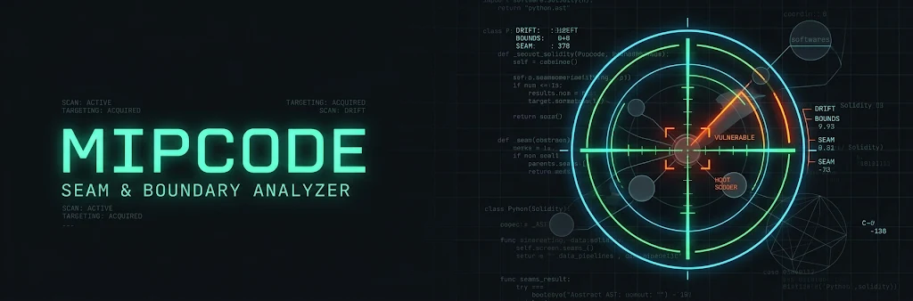

# MipCode

MipCode's `mip-delta` command checks Python changes for call sites, wrappers,
and overrides that may need to change with them. It can also review a Python
repository snapshot, run structural and fork-vs-upstream checks on Solidity
source, and check Solana/Anchor `#[derive(Accounts)]` constraint symmetry.
This is a research preview. Findings are prompts for review.

## Install

Use Python 3.10 or later. The base package has no third-party Python runtime
dependencies. Install Git for Python repository auditing and Git comparisons.

```sh
python -m pip install coherion-mipcode
mip-delta --version
```

## Run

From your project's root, inspect Python source for existing issues:

```sh
mip-delta --root . --audit-repo
```

In a Git checkout, compare your working tree with `HEAD` and get JSON output:

```sh
mip-delta --root . --check-git --json
```

For a Solidity source tree:

```sh
mip-delta --root . --audit-solidity
```

Compare a Solidity fork against its upstream contracts (research preview):

```sh
mip-delta --fork-diff --upstream upstream_contracts/ --root fork_contracts/
```

For a Solana/Anchor Rust program workspace (research preview):

```sh
mip-delta --root programs/ --audit-anchor
```

These commands analyze source locally. Runtime observation with
`--run-pytest` is opt-in and requires Python 3.12 or later and pytest.
Model-assisted review with `--review` is also opt-in and uses configured
Anthropic API credentials or an authenticated Claude CLI.

For pull requests, use the [MipCode PR Caller Check on GitHub Marketplace](https://github.com/marketplace/actions/mipcode-pr-caller-check).
See the [usage guide](https://github.com/Nitefawkes/mipcode/blob/main/docs/usage.md)
for CI, pre-commit hooks, and command options, or the
[source repository](https://github.com/Nitefawkes/mipcode) for evaluation results.

MipCode is licensed under Apache-2.0.
